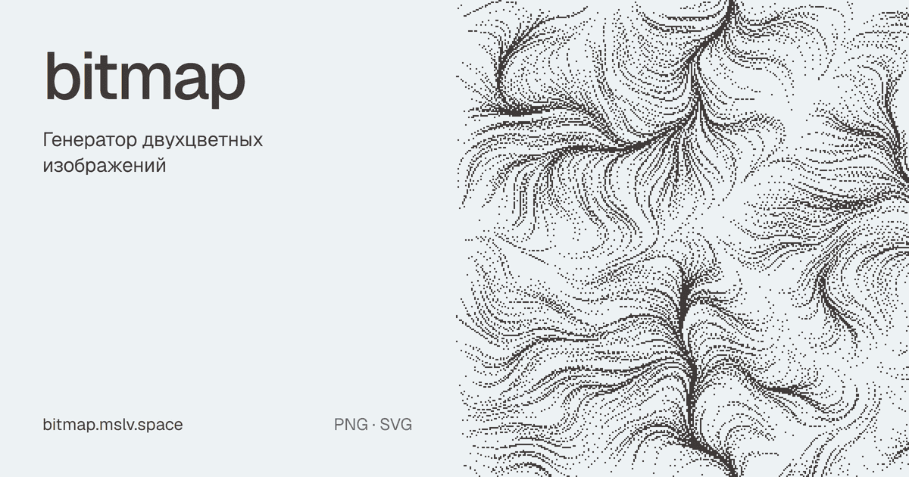

# bitmap

https://bitmap.mslv.space

A generator of two-color bitmap images. Every generation is unique: the image is defined by a short seed, and the same link always opens the same image.



## Features

- **Generative bases.** Strange attractors (Clifford, de Jong, Svensson, Bedhead), Gray–Scott reaction-diffusion, flow lines, noise with domain warp (smoke, marble, contour lines, terraces), interference and moiré, heat field, ridges, ringed planets, spirals, Voronoi, superformula.
- **Composition.** Sometimes two layers (multiply, mask, difference, screen), mirror and kaleidoscope symmetry, full-frame, horizon or soft-fade composition, contour lines and posterization.
- **Dithering.** Atkinson, Floyd–Steinberg, Jarvis–Judice–Ninke, Stucki, Sierra Lite, Bayer 2/4/8, blue noise (void-and-cluster), IGN, dot and line halftone, threshold. Leave it on "Auto" or pick one manually.
- **Quality filter.** Variants that are too empty, too solid or structureless are discarded before they're shown.
- **Format.** 1:1, 4:5, 3:4, 2:3, 9:16, 16:9, 3:2, 21:9, A4 or a custom size up to 8192 px per side; pixel size from 1 to 16.
- **Palettes.** Eight two-color pairs plus custom colors. The palette changes instantly, without re-rendering.
- **Export.** PNG at exactly the chosen resolution, and SVG with the ink merged into rectangles.
- **Links and history.** All settings are stored in the page URL. The last 12 images are available in the history strip.
- **Interface** in Russian and English.

Hotkeys: Space — new image, ← → — history, P — PNG, S — SVG.

## Running

No build step: it's a static site built on ES modules, with the heavy computation running in a Web Worker.

```sh
npx serve .
```

Generator checks (determinism, variety, quality filter, SVG geometry):

```sh
node tests/run.js
```

## How it works

| File | What it does |
| --- | --- |
| `gen/rng.js` | seed → random number generator (cyrb128 + sfc32) |
| `gen/noise.js` | Perlin noise, fBm, ridged, domain warp |
| `gen/fields.js` | generative bases, coordinates normalized to the frame height |
| `gen/recipe.js` | seed → recipe: layers, symmetry, composition, tone, dithering |
| `gen/dither.js` | dithering algorithms |
| `gen/quality.js` | filter for boring results |
| `render.worker.js` | rendering in a background thread |
| `export.js` | PNG and SVG |
| `app.js`, `i18n.js` | interface and translations |

## License

[MIT with Attribution](LICENSE) © 2026 oxolegit. Public use requires a visible link to this repository: https://github.com/oxolegit/bitmap
